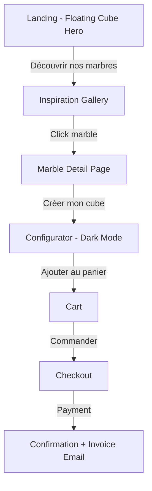

# Marmorani UX Design Specification

_Created on 2025-12-04 by Sacha_
_Generated using BMad Method - Create UX Design Workflow v1.0_

---

## Executive Summary

**Project:** Marmorani - The first e-commerce platform dedicated exclusively to custom marble cube creation. A category-defining product that transforms complex manufacturer interactions into an intuitive, immersive online experience.

**Target Users:**
- **Individual Consumers**: Homeowners and design enthusiasts seeking unique marble cubes for living spaces (coffee tables, side tables, decorative columns)
- **Interior Design Professionals**: Architects and designers requiring custom marble pieces for client projects

**Core Value Proposition:** Instant understanding, transparent pricing, photo-realistic 3D visualization, and seamless ordering.

**Competitive Advantage:** Vertical integration (ownership of manufacturing + marble supply) enables accessible pricing impossible for traditional manufacturers.

**Visual Direction:** "Luxe Minimaliste Moderne" - refined elegance with bold contemporary touches, clean white spaces meeting striking contrasts.

---

## 1. Design System Foundation

### 1.1 Design System Choice

**Selected:** shadcn/ui with Tailwind CSS

**Rationale:**
- Minimal aesthetic aligns perfectly with "Luxe Minimaliste Moderne" vision
- Components are copied into codebase (no external dependency, full control)
- Highly customizable to match Armani Casa-inspired elegance
- Lightweight components won't impact 3D configurator performance
- No recognizable "look" - Marmorani brand remains unique
- Built-in accessibility (WCAG 2.1 AA compliant)
- Tailwind CSS enables rapid visual adjustments

**What shadcn/ui Provides:**
- Button variants (primary, secondary, ghost, destructive)
- Form components (inputs, selects, sliders, checkboxes)
- Dialog/Modal system
- Navigation components (tabs, menus, dropdowns)
- Cards and containers
- Toast notifications
- Loading states and skeletons

**Custom Components Needed:**
- 3D Configurator viewport (Three.js/React Three Fiber)
- Marble texture selector with visual previews
- Dimension input with 3D sync
- Price/weight calculator display
- Inspiration gallery grid
- Order tracking timeline

**Version:** Latest (components copied at implementation time)

---

## 2. Core User Experience

### 2.1 Defining Experience

**Signature Experience:** "You sculpt your marble cube in 3D and see exactly what you'll receive"

**The Central Experience:** The immersive 3D configurator is the heart of Marmorani. Users don't fill out a form—they sculpt their creation in a full-screen environment where the marble cube commands complete attention.

**Primary User Action:** Configure and visualize a custom marble cube in photo-realistic 3D
- Select dimensions (height, width, depth)
- Choose marble type from ~10 varieties
- Pick finish (polished, honed, raw)
- See real-time price and weight calculations

**What Must Be Effortless:** The transition from "I see my cube" to "I buy it" - zero friction between visualization confidence and purchase action.

**Critical Interaction to Nail:** The 3D rotation and manipulation that builds purchase confidence without physical samples. Users must feel they're holding their future cube.

**Platform:** Responsive web application
- **Desktop:** Mouse-driven rotation, hover states, side panels for configuration options
- **Mobile:** Touch gestures (drag to rotate, pinch to zoom), bottom sheets for options, swipe interactions
- **Shared:** Same visual quality, same 3D fidelity, same features across all devices

### 2.2 Emotional Design Goals

The emotional response hierarchy defines every UX decision:

| Priority | Emotion | Description | Design Implication |
|----------|---------|-------------|-------------------|
| **1st** | ✨ Wonder & Surprise | "Wow, I can really create this?" | Immersive 3D, smooth animations, reveal moments |
| **2nd** | 🎯 Confidence & Control | "I know exactly what I'll receive" | Photo-realistic visualization, transparent pricing |
| **3rd** | 🎨 Creative & Inspired | "I'm an interior designer" | Configurator feels like a creative tool, not a form |
| **4th** | 😌 Calm & Serene | "A luxurious, peaceful experience" | Generous whitespace, elegant transitions, no clutter |
| **5th** | ⚡ Efficient & Productive | "So simple and fast" | Minimal steps, smart defaults, streamlined checkout |
| **6th** | 🏆 Privileged & Exclusive | "Accessing something special" | Premium aesthetics, refined typography, subtle luxury cues |

**The Defining Emotional Moment:** When a user first rotates their custom marble cube in 3D and sees the realistic veining patterns respond to light—that "wow" moment that makes them want to share it with a friend.

### 2.3 UX Inspiration Analysis

Three key references define Marmorani's UX DNA:

#### Armani Casa - Elegant Sobriety
- **Generous whitespace**: Content floats in luxurious space
- **Bold typography**: Impactful titles with clear hierarchy
- **Restrained palette**: Black, white, neutrals—the product IS the color
- **Minimal navigation**: Decluttered, the product takes center stage

#### BoConcept - Cinematic Immersion  
- **Hero video backgrounds**: Subtle motion captures attention immediately
- **Fluid transitions**: Sections reveal with elegance
- **Lifestyle storytelling**: Real homes, not just products
- **Personalization prominent**: "Infinite possibilities, designed for you"

#### Rolex Configurator - The Gold Standard
- **Product-centered (70%+ screen)**: The watch dominates, controls are secondary
- **Discreet controls**: Side panels, never intrusive
- **Photo-realistic rendering**: Indistinguishable from real photography
- **Instant feedback**: Every selection updates the view immediately
- **Natural rotation**: Intuitive gestures to explore the product
- **Clear progression**: Numbered steps through configuration

**Synthesis for Marmorani:**
| Pattern | Source | Implementation |
|---------|--------|----------------|
| Luxurious whitespace | Armani Casa | Interface fades, cube breathes |
| Bold typography | Armani Casa | Impactful headers, clear hierarchy |
| Hero animation | BoConcept | Slow-rotating cube on landing |
| Fluid transitions | BoConcept | Smooth animations between sections |
| Product-centered 70%+ | Rolex | Full-screen immersive configurator |
| Discreet controls | Rolex | Non-intrusive side panel |
| Photo-realistic render | Rolex | High-fidelity marble textures |

### 2.2 Core Experience Principles

These principles guide every UX decision:

| Principle | Marmorani Approach | Rationale |
|-----------|-------------------|-----------|
| **Speed** | Instantaneous (<500ms) | Configurator responds immediately; users never wait |
| **Guidance** | Minimalist, smart defaults | Design-conscious users don't need hand-holding |
| **Flexibility** | Simple first, advanced accessible | Essential options visible, details on demand |
| **Feedback** | Subtle, elegant, product-speaks | No confetti; the cube transformation IS the feedback |

**Design Implications:**
- No loading spinners in configurator—use skeleton states if needed
- Smart defaults pre-selected (most popular marble, standard dimensions)
- Progressive disclosure: basic options visible, advanced expandable
- Transitions inspired by BoConcept: fluid, cinematic, never jarring
- The 3D cube is the primary feedback mechanism—it changes, user understands

### 2.3 Novel UX Patterns

**Assessment:** No novel patterns required.

The Marmorani experience combines established patterns:
- Product configuration (Tesla, Nike By You, Rolex)
- Interactive 3D visualization (Apple, IKEA Place)
- Classic e-commerce (cart → checkout → confirmation)
- Real-time pricing calculation

**The Challenge:** Execute a 3D configurator at Rolex-level quality, not invent new interactions.

---

## 3. Visual Foundation

### 3.1 Color System

**Strategy:** Dual-atmosphere approach for maximum visual impact

| Context | Theme | Rationale |
|---------|-------|-----------|
| **General site** | Carrara Pure | Clean, luxurious, accessible—pages breathe |
| **3D Configurator** | Nero Marquina | Dark backdrop makes marble textures pop |

**The Transition Moment:** Entering the configurator triggers a cinematic fade from white to black—users feel they're stepping into a private atelier.

#### Carrara Pure (General Site)

| Role | Color | Hex | Usage |
|------|-------|-----|-------|
| Background | Pure White | `#FFFFFF` | Page backgrounds |
| Surface | Soft Gray | `#F8F8F8` | Cards, sections |
| Border | Light Gray | `#E5E5E5` | Dividers, inputs |
| Secondary | Charcoal | `#4A4A4A` | Secondary text |
| Primary | Deep Black | `#1A1A1A` | Headlines, primary actions |

#### Nero Marquina (Configurator)

| Role | Color | Hex | Usage |
|------|-------|-----|-------|
| Background | Rich Black | `#0D0D0D` | Configurator backdrop |
| Surface | Dark Gray | `#1A1A1A` | Panels, controls |
| Border | Medium Gray | `#2D2D2D` | Subtle separators |
| Accent | Champagne Gold | `#C9A962` | CTAs, prices, highlights |
| Text | Pure White | `#FFFFFF` | All text on dark |

#### Semantic Colors (Both Modes)

| State | Light Mode | Dark Mode |
|-------|-----------|-----------|
| Success | `#E8F5E9` / `#2E7D32` | `#1B3D2F` / `#4ADE80` |
| Warning | `#FFF8E1` / `#F57C00` | `#3D351B` / `#FBBF24` |
| Error | `#FFEBEE` / `#C62828` | `#3D1B1B` / `#F87171` |
| Info | `#E3F2FD` / `#1565C0` | `#1B2D3D` / `#60A5FA` |

### 3.2 Typography System

**Font Selection:**

| Role | Font | Weight | Rationale |
|------|------|--------|-----------|
| Headlines | Cormorant Garamond | 500-700 | Elegant serif, luxury feel, pairs with marble |
| Body | Inter | 300-500 | Clean, highly readable, modern sans-serif |
| Monospace | JetBrains Mono | 400 | Dimensions, technical specs |

**Type Scale:**

| Element | Size | Weight | Letter Spacing |
|---------|------|--------|----------------|
| H1 | 3rem (48px) | 600 | 0.15em |
| H2 | 2.25rem (36px) | 600 | 0.1em |
| H3 | 1.5rem (24px) | 500 | 0.05em |
| Body | 1rem (16px) | 400 | 0 |
| Small | 0.875rem (14px) | 400 | 0 |
| Caption | 0.75rem (12px) | 500 | 0.05em |
| Price | 1.5rem (24px) | 600 | 0 |

### 3.3 Spacing System

**Base Unit:** 4px

| Token | Value | Usage |
|-------|-------|-------|
| xs | 4px | Tight gaps, icon padding |
| sm | 8px | Input padding, small gaps |
| md | 16px | Component padding, standard gaps |
| lg | 24px | Section padding, card spacing |
| xl | 32px | Large sections |
| 2xl | 48px | Page sections |
| 3xl | 64px | Hero spacing |

**Layout Grid:** 12-column with 24px gutters

**Container Widths:**
- Mobile: 100% with 16px padding
- Tablet: 100% with 32px padding
- Desktop: 1280px max-width, centered

**Interactive Visualizations:**

- Color Theme Explorer: [ux-color-themes.html](./ux-color-themes.html)

---

## 4. Design Direction

### 4.1 Chosen Design Approach

**Direction:** Centered Minimal with Golden Accents (Hybrid A-refined)

**Core Concept:** The marble cube floats freely in a sea of white. No frames, no boxes—just pure, breathing space with the product as absolute hero. Golden accents add luxury without heaviness.

**Visual Philosophy:**
- **Background:** Pure white (#FFFFFF) throughout the main experience
- **Cube:** Floats centered, casting subtle shadow, commanding attention
- **Accents:** Champagne gold (#C9A962) for CTAs, prices, and key highlights
- **Typography:** Cormorant Garamond for elegance, Inter for clarity
- **Whitespace:** Generous, Armani Casa-inspired breathing room

**Key Design Decisions:**

| Element | Decision | Rationale |
|---------|----------|-----------|
| Hero Layout | Centered vertical, cube floating mid-screen | Maximum visual impact, product as art |
| Cube Container | No frame/box, floats on white | Cleaner, more luxurious, less visual noise |
| Primary CTA | Gold (#C9A962) button | Luxury accent that draws eye without harshness |
| Config Bar | Pill-shaped, below cube | Non-intrusive, accessible, clear hierarchy |
| Navigation | Minimal top bar, charcoal text | Disappears into background, cube dominates |
| Price Display | Gold accent color | Associates price with luxury, not cost |

**Configurator Transition:**
When entering the configurator for detailed manipulation, transition to Nero Marquina (dark mode) to make marble textures pop during close inspection. The white homepage is the "gallery view," dark configurator is the "workshop view."

**Inspiration Synthesis:**
- **Armani Casa:** Whitespace, restraint, product as hero
- **BoConcept:** Fluid transitions, cinematic reveals
- **Rolex Configurator:** Product-centered, instant feedback

**Interactive Mockups:**

- Design Direction Showcase: [ux-design-directions.html](./ux-design-directions.html)
- Refined Hybrids: [ux-design-directions-refined.html](./ux-design-directions-refined.html)

---

## 5. User Journey Flows

### 5.1 Critical User Paths

**Primary Journey Pattern:** Inspiration First
Users discover the beauty of marble, connect emotionally with a specific type, then create their custom cube.

#### Journey 1: Configure & Buy (Primary Revenue Path)

**Philosophy:** Seduce before selling. Wonder before action.

**Flow:**



**Step Details:**

| Step | Screen | User Action | System Response | Emotion |
|------|--------|-------------|-----------------|---------|
| 1 | Landing | Sees floating cube, clicks "Discover" | Smooth scroll/transition to gallery | Wonder |
| 2 | Gallery | Browses marble grid, hovers for preview | Shows marble name + "from X €" | Curiosity |
| 3 | Marble Detail | Reads story, sees examples | Rich content, lifestyle imagery | Connection |
| 4 | Configurator | Adjusts dimensions, finish | Real-time 3D update, live pricing | Creativity |
| 5 | Cart | Reviews configuration | Visual recap with mini 3D cube | Confidence |
| 6 | Checkout | Enters address, pays | Secure Stripe flow | Trust |
| 7 | Confirmation | Receives confirmation | Email with invoice, order tracking | Satisfaction |

**Configurator Interaction Pattern:**
- **Entry:** Guided (marble pre-selected from gallery → dimensions → finish)
- **Editing:** Flexible (all options accessible simultaneously, change anything anytime)
- **Principle:** "Guided Entry, Flexible Editing"

#### Journey 2: Discover & Explore (Pre-Purchase)

Users exploring possibilities without immediate purchase intent.

**Flow:** Landing → Gallery → Marble Details → (Save for later / Exit)

**Key UX:** No pressure, educational, builds desire for future purchase.

#### Journey 3: Track Order (Post-Purchase)

**Flow:** Email link → Order Dashboard → Status Timeline → Tracking Info

**Key UX:** Transparent, proactive updates, reduces anxiety during 4-week wait.

#### Journey 4: Return Visit (Repeat Purchase)

**Flow:** Direct to Gallery/Configurator → Quick configuration → Checkout

**Key UX:** Remember preferences, streamlined for returning users.

---

## 6. Component Library

### 6.1 Component Strategy

**Base:** shadcn/ui + Tailwind CSS (copied into codebase, full control)

#### shadcn/ui Components (Ready to Use)

| Component | Marmorani Usage |
|-----------|-----------------|
| Button | CTAs (gold primary, black secondary, ghost) |
| Input | Dimensions, addresses, forms |
| Select | Finish options, country selection |
| Slider | Dimension adjustment (optional) |
| Card | Gallery items, cart items |
| Dialog | Confirmations, marble quick-view |
| Toast | Notifications, success messages |
| Tabs | Configurator sections (if needed) |

#### Custom Components (To Build)

| Component | Description | Key States |
|-----------|-------------|------------|
| **Cube3DViewer** | Three.js viewport with rotation, zoom, lighting | Loading, Ready, Error |
| **MarbleSelector** | Grid of marble swatches with preview | Default, Hover, Selected |
| **DimensionInput** | H×W×D inputs synced with 3D | Valid, Invalid, Focused |
| **PriceCalculator** | Live price + weight display | Calculating, Ready |
| **FinishPicker** | Visual finish selector (polished, honed, raw) | Default, Selected |
| **ConfigBar** | Bottom pill-shaped config summary | Collapsed, Expanded |
| **MarbleCard** | Gallery card with hover overlay | Default, Hover, Loading |
| **OrderTimeline** | Visual order status tracker | Pending, Current, Complete |

### 6.2 Pricing Display Strategy

**Critical UX Note:** Shipping costs depend on weight and dimensions.

| Display Context | What to Show |
|-----------------|--------------|
| **Gallery** | "À partir de X €" (base price, no shipping) |
| **Configurator** | Product price only + weight indicator |
| **Cart** | Product price + "Livraison calculée à l'étape suivante" |
| **Checkout (address entered)** | Product + Shipping = Total |

**Transparency Pattern:**
- Always show weight in configurator (helps user understand shipping impact)
- Never surprise user with hidden costs
- Show shipping estimate range before address: "Livraison estimée: 50-150€ selon destination"
- Final shipping calculated once address entered

**Weight Display:** Show weight prominently in configurator (e.g., "≈ 45 kg") so users understand marble is heavy and shipping will be significant.

---

## 7. UX Pattern Decisions

### 7.1 Consistency Rules

**Design Philosophy:** Luxe Minimaliste — every interaction should feel refined, never jarring.

#### Button Hierarchy

| Type | Style | Usage |
|------|-------|-------|
| Primary | Gold (#C9A962), solid | Main CTAs (Commander, Créer) |
| Secondary | Black outline | Secondary actions (Voir plus) |
| Ghost | Text with underline | Tertiary (Détails, Annuler) |
| Destructive | Red outline | Delete, cancel order |

#### Feedback Patterns

| Type | Pattern | Behavior |
|------|---------|----------|
| Success | Toast bottom-right | Auto-dismiss 4s, subtle slide-in |
| Error | Inline below field + red border | Persistent until fixed |
| Warning | Yellow banner top of section | Dismissible |
| Loading | Skeleton states | No spinners, elegant shimmer |
| Progress | Thin progress bar | For multi-step (checkout) |

#### Form Patterns

| Aspect | Decision |
|--------|----------|
| Label position | Above input |
| Required indicator | Asterisk (*) after label |
| Validation timing | onBlur (when leaving field) |
| Error display | Inline, below input, red text |
| Help text | Small gray text below input |
| Placeholder | Light gray, example values |

#### Modal Patterns

| Aspect | Decision |
|--------|----------|
| Backdrop | Blur + dark overlay (50% opacity) |
| Position | Centered vertically and horizontally |
| Close triggers | X button, Escape key, click outside |
| Focus | Auto-focus first interactive element |
| Animation | Fade + subtle scale (0.95 → 1) |

#### Navigation Patterns

| Aspect | Decision |
|--------|----------|
| Active state | Bold text + underline |
| Hover state | Color transition (gray → black/gold) |
| Mobile nav | Hamburger → full-screen overlay |
| Back button | Browser back works naturally |

#### Empty States

| Context | Pattern |
|---------|---------|
| Empty cart | Illustration + "Votre panier est vide" + CTA to gallery |
| No orders | "Aucune commande" + CTA to create first cube |
| No search results | "Aucun résultat" + suggestions |

#### Confirmation Patterns

| Action | Confirmation Required |
|--------|----------------------|
| Delete from cart | Yes, modal |
| Cancel order | Yes, modal with reason |
| Leave unsaved config | Yes, "Quitter sans sauvegarder?" |
| Add to cart | No, toast confirmation |
| Complete purchase | No, direct to success page |

#### Notification Patterns

| Aspect | Decision |
|--------|----------|
| Position | Bottom-right (desktop), bottom-center (mobile) |
| Duration | 4 seconds auto-dismiss |
| Stacking | Max 3 visible, newest on top |
| Actions | Optional action button (e.g., "Voir panier") |

---

## 8. Responsive Design & Accessibility

### 8.1 Responsive Strategy

**Philosophy:** Equal experience, adapted execution. Same quality, optimized for each device.

#### Breakpoints

| Breakpoint | Width | Columns | Key Adaptations |
|------------|-------|---------|-----------------|
| Mobile | < 768px | 4 | Hamburger nav, bottom sheet config, full-width cube |
| Tablet | 768-1024px | 8 | Visible nav, reduced side panel |
| Desktop | > 1024px | 12 | Full experience, side panel config |

#### Component Adaptations

| Component | Desktop | Mobile |
|-----------|---------|--------|
| Navigation | Horizontal top bar | Hamburger → fullscreen overlay |
| Configurator | Side panel + 70% cube | Bottom sheet + 60% cube |
| Gallery | 3-column grid | 2-column grid |
| Config Bar | Horizontal pill | Stacked vertical |
| Modals | Centered, max 600px | Full-screen |
| Forms | Inline labels possible | Labels always above |

#### Configurator Mobile Experience

```
┌─────────────────────────┐
│      ≡  MARMORANI       │  ← Hamburger nav
├─────────────────────────┤
│                         │
│                         │
│      ╔═══════════╗      │  ← Cube 3D (60% height)
│      ║   CUBE    ║      │     Drag to rotate
│      ║    3D     ║      │     Pinch to zoom
│      ╚═══════════╝      │
│                         │
├─────────────────────────┤
│  ═══════════════════    │  ← Drag handle
│  Carrara │ 30cm │ Poli  │  ← Bottom sheet (collapsed)
│  890 € [Commander]      │
└─────────────────────────┘

        ↓ Drag up ↓

┌─────────────────────────┐
│  Dimensions             │  ← Bottom sheet (expanded)
│  [30] × [30] × [30] cm  │
│                         │
│  Marbre                 │
│  ○ ○ ● ○ ○ ○           │
│                         │
│  Finition               │
│  [Poli      ▼]          │
│                         │
│  890 € [Commander ▶]    │
└─────────────────────────┘
```

#### Touch Interactions

| Gesture | Action |
|---------|--------|
| Drag on cube | Rotate 3D view |
| Pinch | Zoom in/out |
| Swipe bottom sheet | Expand/collapse config |
| Tap marble swatch | Select marble type |

### 8.2 Accessibility Strategy

**Target:** WCAG 2.1 Level AA Compliance

#### Color & Contrast

| Requirement | Implementation |
|-------------|----------------|
| Text contrast | 4.5:1 minimum (body), 3:1 (large text) |
| UI contrast | 3:1 for interactive elements |
| Color independence | Never rely on color alone for meaning |
| Focus indicator | 2px solid outline, visible on all backgrounds |

#### Keyboard Navigation

| Requirement | Implementation |
|-------------|----------------|
| Tab order | Logical flow: nav → content → actions |
| Focus visible | Custom focus ring (gold on dark, black on light) |
| Activation | Enter/Space for buttons and links |
| Escape | Close modals, cancel actions |
| Arrow keys | Navigate marble selector, dimension inputs |

#### Screen Reader Support

| Element | ARIA Implementation |
|---------|---------------------|
| Cube 3D Viewer | `aria-label="Aperçu 3D de votre cube: [marbre], [dimensions], [finition]"` |
| Price updates | `aria-live="polite"` for dynamic price changes |
| Marble selector | `role="radiogroup"` with labeled options |
| Loading states | `aria-busy="true"` during calculations |

#### 3D Fallback

For users without WebGL or using screen readers:
- Display high-quality static image of selected marble
- Text description: "Cube [marbre] [H×L×P cm], finition [type], poids estimé [X kg]"
- All configuration options remain fully functional

#### Touch Targets

| Device | Minimum Size |
|--------|--------------|
| Mobile | 44×44px (iOS/Android guidelines) |
| Desktop | 24×24px with adequate spacing |

---

## 9. Implementation Guidance

### 9.1 Completion Summary

**UX Design Specification Complete!**

#### What We Created Together

| Deliverable | Decision | Rationale |
|-------------|----------|-----------|
| **Design System** | shadcn/ui + Tailwind | Minimal, customizable, performant |
| **Color Strategy** | Carrara Pure (site) + Nero Marquina (configurator) | Dual-atmosphere for impact |
| **Design Direction** | Centered Minimal + Golden Accents | Cube floats on white, gold CTAs |
| **Primary Journey** | Inspiration First | Galerie → Détail → Configurateur → Checkout |
| **Configurator UX** | Guided Entry, Flexible Editing | Pre-select from gallery, then full control |
| **Responsive** | Mobile-first with bottom sheet config | Same quality, adapted interaction |
| **Accessibility** | WCAG 2.1 AA | Inclusive, legally compliant |

#### Key Design Decisions

1. **Emotional Hierarchy:** Wonder → Confidence → Creativity → Serenity
2. **Visual Direction:** Luxe Minimaliste Moderne (Armani Casa + BoConcept + Rolex)
3. **Cube Presentation:** Floats freely on white, no frame, maximum breathing room
4. **Golden Accents:** #C9A962 for primary CTAs and prices
5. **Configurator Transition:** Cinematic fade from light to dark mode
6. **Pricing Transparency:** Product price visible, shipping calculated at address entry

#### Interactive Deliverables

- **Color Theme Explorer:** [ux-color-themes.html](./ux-color-themes.html)
- **Design Directions (6):** [ux-design-directions.html](./ux-design-directions.html)
- **Refined Hybrids (5):** [ux-design-directions-refined.html](./ux-design-directions-refined.html)

### 9.2 Next Steps

This UX Design Specification provides the foundation for:

1. **Architecture Workflow** → Technical decisions with UX context
2. **Wireframe Generation** → Detailed screen layouts
3. **Prototype Development** → Interactive HTML/Figma prototypes
4. **Frontend Implementation** → Component development with clear specs

### 9.3 Design Tokens Reference

For implementation, use these design tokens:

```css
/* Colors - Carrara Pure (Light) */
--color-bg: #FFFFFF;
--color-surface: #F8F8F8;
--color-border: #E5E5E5;
--color-text-secondary: #4A4A4A;
--color-text-primary: #1A1A1A;

/* Colors - Nero Marquina (Dark/Configurator) */
--color-dark-bg: #0D0D0D;
--color-dark-surface: #1A1A1A;
--color-dark-border: #2D2D2D;
--color-accent: #C9A962;
--color-dark-text: #FFFFFF;

/* Typography */
--font-display: 'Cormorant Garamond', serif;
--font-body: 'Inter', sans-serif;
--font-mono: 'JetBrains Mono', monospace;

/* Spacing */
--space-xs: 4px;
--space-sm: 8px;
--space-md: 16px;
--space-lg: 24px;
--space-xl: 32px;
--space-2xl: 48px;
--space-3xl: 64px;

/* Transitions */
--transition-default: all 0.3s cubic-bezier(0.4, 0, 0.2, 1);
```

---

## Appendix

### Related Documents

- Product Requirements: `docs/prd.md`
- Product Brief: `docs/product-brief-Marmorani-2025-11-25.md`

### Core Interactive Deliverables

This UX Design Specification was created through visual collaboration:

- **Color Theme Visualizer**: docs/ux-color-themes.html
  - Interactive HTML showing all color theme options explored
  - Live UI component examples in each theme
  - Side-by-side comparison and semantic color usage

- **Design Direction Mockups**: docs/ux-design-directions.html
  - Interactive HTML with 6-8 complete design approaches
  - Full-screen mockups of key screens
  - Design philosophy and rationale for each direction

### Version History

| Date       | Version | Changes                         | Author |
| ---------- | ------- | ------------------------------- | ------ |
| 2025-12-04 | 1.0     | Initial UX Design Specification | Sacha  |

---

_This UX Design Specification was created through collaborative design facilitation, not template generation. All decisions were made with user input and are documented with rationale._

